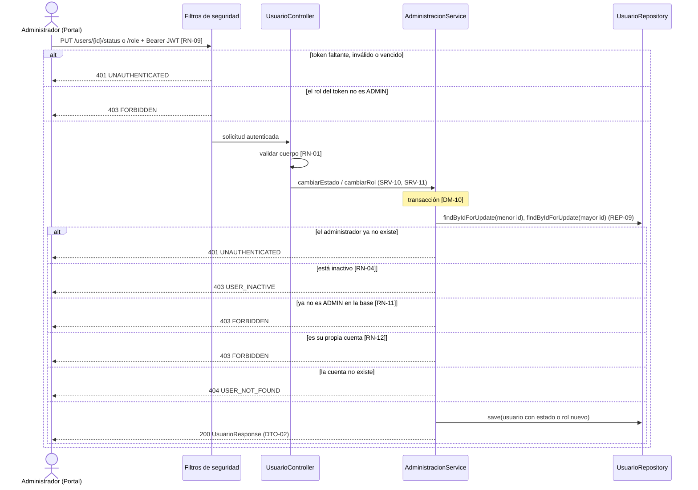
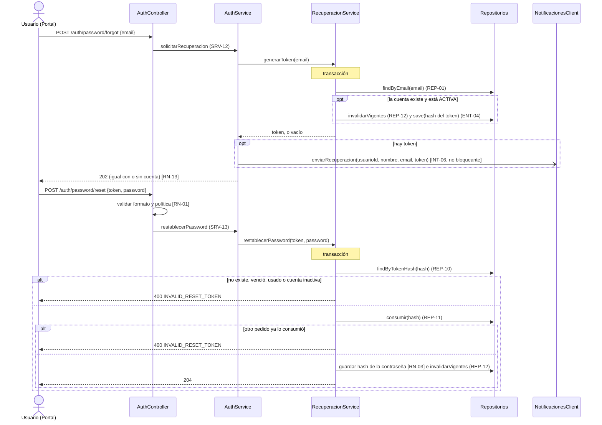
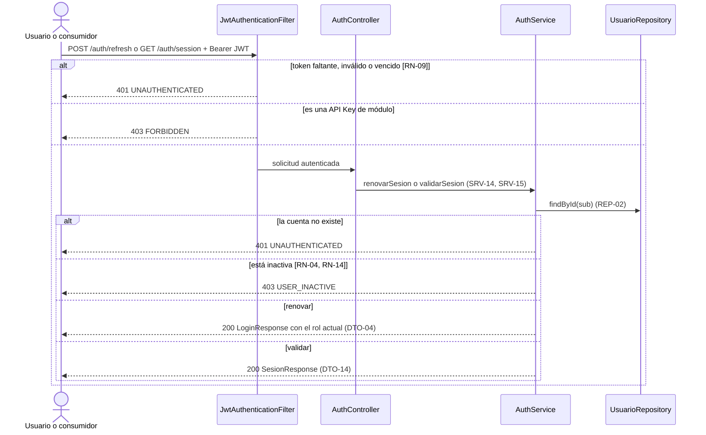
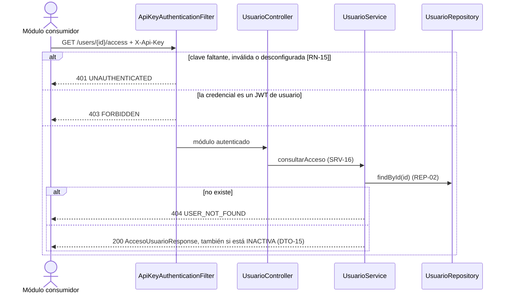

# Diseño de los casos de uso de evolución (CU-06 a CU-10)

Este documento completa el diseño de `G02_Usuarios_PrimeraEntrega_v1.5.pdf`, que desarrolló en profundidad los cinco CU CORE y dejó los cinco de evolución "fuera de esta entrega, pero con el diseño preparado". Sigue la misma convención de identificadores (CU, RN, ENT, DM, SEC, SRV, REP, API, DTO, INT): los IDs nuevos continúan la numeración del PDF y no reutilizan ninguno. El contrato está en [deliverygo-usuarios.yaml](deliverygo-usuarios.yaml); lo ya diseñado en el PDF no se modifica salvo lo indicado en "Cambios sobre lo ya diseñado".

## De dónde salen las decisiones

El backlog de la guía funcional fija el nombre y los módulos relacionados de cada CU. El PDF ya había dejado anticipadas varias decisiones: DM-05 (estado como enumerado, para CU-06), DM-07 (roles distintos de CLIENTE se cargan como datos iniciales y los administra CU-07), DM-03 (CU-09 puede sumar un token de renovación sin romper el modelo) y la conclusión de que la credencial de los módulos consumidores y la distribución de la verificación del JWT quedaban por acordar.

De las clases se tomó lo siguiente:

- Autenticación responde "¿quién sos?" y autorización "¿qué podés hacer?": sin token o con token inválido, 401; con rol insuficiente, 403; operación exitosa, 2xx. Las operaciones destructivas o de administración las ejecuta un ADMIN y los demás roles reciben 403.
- Entre APIs hay tres opciones de seguridad: API Key ("simple, útil para integraciones controladas"), OAuth 2.0 Client Credentials ("patrón habitual servicio a servicio") y el token JWT, que no tiene estado y maneja el concepto de expiración.
- El 204 es la respuesta de operaciones sin contenido; el estado de las entidades permite "desactivarlas" sin perder información.
- Para integrar los módulos hace falta que cada equipo conozca el contrato del resto (Swagger) antes de integrarse.

Lo que ni las clases ni el PDF definen (quién puede desactivar, cómo se recupera una contraseña, cómo se identifica un módulo) lo decidió el equipo y queda registrado abajo como decisión propia, no como exigencia de la cátedra.

## Estado de los casos de uso

| CU | Caso de uso | Módulos relacionados | Contrato | Estado |
|---|---|---|---|---|
| CU-06 | Desactivar o reactivar usuario | Portal / Administración | API-10 | Implementado y probado |
| CU-07 | Asignar o modificar rol | Portal / Administración | API-11 | Implementado y probado |
| CU-08 | Recuperar o restablecer contraseña | Notificaciones | API-12, API-13 | Implementado y probado; Notificaciones es un mock declarado |
| CU-09 | Renovar o validar sesión/token | Todos los consumidores | API-14, API-15 | Implementado y probado |
| CU-10 | Consultar estado y rol para otro módulo | Pedidos, Catálogo, Logística | API-16 | Implementado y probado |

## Reglas de negocio nuevas

| ID | Regla | CU | Dónde se aplica |
|---|---|---|---|
| RN-11 | Sólo un administrador ACTIVO puede cambiar el estado o el rol de una cuenta. Se comprueba contra la base en cada operación, no sólo con el rol del token, que puede estar desactualizado hasta vencer. | CU-06, CU-07 | `AdministracionService` (SRV-10, SRV-11) |
| RN-12 | Un administrador no puede cambiar su propio estado ni su propio rol, para que el sistema nunca quede sin administradores. Dos administradores que se modifican entre sí al mismo tiempo no se dejan sin ninguno: las filas se bloquean en orden de id. | CU-06, CU-07 | SRV-10, SRV-11 / REP-09 |
| RN-13 | La recuperación de contraseña no revela si el email existe ni su estado (siempre 202). El token es de un solo uso, vence a los 30 minutos (configurable), sólo se guarda su hash y un pedido nuevo deja sin efecto los anteriores. Un token de una cuenta inactiva no sirve. Ante dos pedidos simultáneos con el mismo token, sólo uno se aplica. | CU-08 | `RecuperacionService` (SRV-12, SRV-13) / REP-10 a REP-12 |
| RN-14 | Sólo se renueva una sesión vigente y de una cuenta ACTIVA. El token nuevo lleva el rol actual de la base. Un token vencido no se renueva. | CU-09 | SRV-14 |
| RN-15 | Cada módulo consumidor se identifica con su propia API Key y sólo puede leer: API-03 (todos), API-05 (sólo Pedidos) y API-16 (todos). Un módulo nunca escribe y un rol humano no lo reemplaza. Una clave vacía o de menos de 16 caracteres deja al módulo sin acceso. | CU-03, CU-05, CU-10 | `ApiKeyAuthenticationFilter`, `Acceso` |

RN-05 (cada usuario opera sólo sobre sus datos; cada módulo, sólo sobre los contratos autorizados) y RN-04 (sólo un usuario ACTIVO opera) siguen vigentes; RN-11 a RN-15 las completan.

## Entidad nueva

| ID | Entidad | Justificación | CU | RN |
|---|---|---|---|---|
| ENT-04 | TokenRecuperacion | Registra los tokens de recuperación para poder hacerlos de un solo uso y con vencimiento. Atributos: id, usuario (muchos a uno, REL-03), tokenHash (único, SHA-256), creadoEn, expiraEn, usadoEn. No es una sesión: DM-03 sigue valiendo para el JWT. | CU-08 | RN-13 |

REL-03: Usuario 1 a 0..* TokenRecuperacion; navegable desde TokenRecuperacion hacia Usuario (lado dueño, `usuario_id`), con carga diferida, igual que REL-01 (DM-12).

## Decisiones de modelado nuevas

| ID | Decisión | Alternativas consideradas | Motivo |
|---|---|---|---|
| DM-13 | La administración (CU-06, CU-07) la hace un ADMIN verificado contra la base, con rutas bajo `/users/{id}` y no un prefijo `/admin`. | Confiar en el claim `role` del token; rutas separadas de administración. | Si se degrada o desactiva a un administrador, su token sigue siendo válido hasta vencer: confiar en el claim lo dejaría operando. Las rutas siguen la convención de recursos de la consigna. |
| DM-14 | El token de recuperación es un valor aleatorio de 256 bits, persistido sólo como hash (ENT-04). | JWT firmado de recuperación sin persistir; código numérico corto. | Un token sin estado no puede ser de un solo uso. El hash evita que una filtración de la base entregue tokens vigentes. Un código corto es adivinable. |
| DM-15 | Renovación deslizante: un JWT vigente se canjea por uno nuevo, sin token de renovación persistido. | Refresh token persistido (anticipado en DM-03); sin renovación. | Mantiene la sesión sin estado (DM-03) y sin entidades nuevas. Tiene un costo: un token robado y todavía vigente puede renovarse mientras la cuenta esté ACTIVA; se corta con CU-06. |
| DM-16 | Los módulos consumidores se identifican con una API Key propia (`X-Api-Key`), sólo lectura. | OAuth 2.0 Client Credentials; JWT de servicio firmado por Usuarios; certificados. | Es la opción simple de la clase para integraciones controladas, y necesita sólo una variable de entorno por módulo. OAuth exige un servidor de autorización que el ecosistema no tiene; un JWT de servicio exige acordar claves entre los equipos. Si los equipos prefieren otra, se reemplaza el filtro sin tocar los casos de uso. |
| DM-17 | El JWT no se revoca: su rol y su estado vigentes se consultan (CU-09, CU-10). | Lista de revocación; validar la base en cada pedido. | Mantiene DM-03 y evita que cada módulo dependa de una consulta por cada llamada. Ver "Limitaciones". |

DM-07 se cumple así: el primer ADMIN se aprovisiona con las variables `ADMIN_EMAIL` y `ADMIN_PASSWORD` al arrancar (sin ellas no se crea ninguno, no hay administrador ni contraseña por defecto) y desde ahí asigna roles con CU-07.

## Fichas

### CU-06 Desactivar o reactivar usuario

| Campo | Contenido |
|---|---|
| Actor principal | Administrador (rol ADMIN), desde el Portal. |
| Objetivo | Dejar una cuenta ACTIVA o INACTIVA sin borrarla. |
| Precondiciones | El administrador presenta una sesión válida y su cuenta está ACTIVA con rol ADMIN en la base (RN-11). |
| Flujo principal | 1. El administrador pide el estado deseado para una cuenta. 2. El sistema verifica la sesión (RN-09) y que sea administrador ACTIVO (RN-11). 3. Verifica que no sea su propia cuenta (RN-12). 4. Verifica que la cuenta exista. 5. Deja la cuenta en el estado pedido; si ya lo tenía, no cambia nada. 6. Devuelve la cuenta. |
| Flujos alternativos | A1 (paso 2). Sesión inválida o vencida: 401. No es administrador: 403 FORBIDDEN. Administrador inactivo: 403 USER_INACTIVE. A2 (paso 3). Su propia cuenta: 403 FORBIDDEN. A3 (paso 4). La cuenta no existe: 404 USER_NOT_FOUND. A4. Estado inválido o campo no permitido: 400 VALIDATION_ERROR. |
| Postcondiciones | Éxito: la cuenta tiene el estado pedido. Una cuenta INACTIVA no inicia sesión (RN-04); sus tokens ya emitidos son rechazados en sus operaciones y en CU-09; los módulos la siguen consultando con su estado (CU-03, CU-10). A1 a A4: no cambia ningún dato. |
| RN / ENT | RN-04, RN-05, RN-09, RN-11, RN-12 / ENT-01 |
| SEC / SRV / API / DTO | SEC-06 / SRV-10 / API-10 / DTO-10, DTO-02, DTO-08 |

### CU-07 Asignar o modificar rol

| Campo | Contenido |
|---|---|
| Actor principal | Administrador (rol ADMIN), desde el Portal. |
| Objetivo | Asignar a una cuenta uno de los roles del catálogo (CLIENTE, COMERCIO, REPARTIDOR, ADMIN). |
| Precondiciones | Las mismas que CU-06. |
| Flujo principal | 1. El administrador pide el rol para una cuenta. 2. El sistema verifica la sesión y que sea administrador ACTIVO (RN-11). 3. Verifica que no sea su propia cuenta (RN-12). 4. Verifica que la cuenta exista. 5. Asigna el rol; si ya lo tenía, no cambia nada. 6. Devuelve la cuenta. |
| Flujos alternativos | Los mismos que CU-06. A4: un rol fuera del catálogo da 400 VALIDATION_ERROR. |
| Postcondiciones | Éxito: la cuenta tiene el rol nuevo. Los tokens emitidos antes conservan el rol anterior hasta vencer (DM-17); el rol vigente lo informan CU-09 y CU-10, y el login o la renovación siguientes emiten el rol nuevo. |
| RN / ENT | RN-05, RN-09, RN-11, RN-12 / ENT-01, ENT-02, REL-02 |
| SEC / SRV / API / DTO | SEC-07 / SRV-11 / API-11 / DTO-11, DTO-02, DTO-08 |

### CU-08 Recuperar o restablecer contraseña

| Campo | Contenido |
|---|---|
| Actor principal | Usuario que olvidó su contraseña, desde el Portal. Actor secundario: Notificaciones. |
| Objetivo | Permitir elegir una contraseña nueva a quien demuestra controlar el email de la cuenta. |
| Precondiciones | Ninguna: son rutas públicas. |
| Flujo principal | **Solicitar.** 1. El usuario indica su email. 2. El sistema valida el formato (RN-01). 3. Si la cuenta existe y está ACTIVA, deja sin efecto los tokens anteriores, genera un token de un solo uso y guarda su hash (RN-13). 4. Pide a Notificaciones que se lo envíe, sin que una falla de esa integración condicione la respuesta (INT-06). 5. Responde 202, haya o no cuenta. **Restablecer.** 6. El usuario envía el token y la contraseña nueva. 7. El sistema valida el formato y la política de contraseña (RN-01). 8. Verifica que el token exista, no haya vencido, no se haya usado y que la cuenta esté ACTIVA. 9. Consume el token y guarda el hash de la contraseña nueva (RN-03). 10. Responde 204. |
| Flujos alternativos | A1 (pasos 2 y 7). Datos inválidos: 400 VALIDATION_ERROR. A2 (paso 3). No hay cuenta o está inactiva: se responde igual, sin enviar nada. A3 (paso 4). Notificaciones falla: el token queda emitido y la respuesta no cambia. A4 (paso 8). Token inexistente, vencido, usado o de cuenta inactiva: 400 INVALID_RESET_TOKEN, sin distinguir la causa. |
| Postcondiciones | Éxito: la contraseña cambió y el token no sirve más; los demás tokens del usuario tampoco. No se inicia sesión. Los JWT emitidos antes siguen vigentes hasta vencer (DM-17). |
| RN / ENT | RN-01, RN-03, RN-13 / ENT-01, ENT-04, REL-03 |
| SEC / SRV / API / DTO / INT | SEC-08 / SRV-12, SRV-13 / API-12, API-13 / DTO-12, DTO-13, DTO-08 / INT-06 |

### CU-09 Renovar o validar sesión/token

| Campo | Contenido |
|---|---|
| Actor principal | Portal Web (renovar) y cualquier consumidor (validar), en nombre de una persona. |
| Objetivo | Renovar una sesión vigente sin pedir la contraseña, y comprobar contra la base si un token sigue siendo utilizable. |
| Precondiciones | Se presenta un JWT. |
| Flujo principal | **Renovar.** 1. Se presenta un JWT vigente. 2. El sistema verifica firma y vencimiento (RN-09). 3. Verifica que la cuenta exista y esté ACTIVA (RN-14). 4. Emite un JWT nuevo con el rol actual y lo devuelve en el mismo formato que el login (DTO-04). **Validar.** Los pasos 1 a 3 son iguales; el sistema devuelve el rol y el estado vigentes y el vencimiento del token (DTO-14). |
| Flujos alternativos | A1 (paso 2). Token faltante, inválido o vencido: 401 UNAUTHENTICATED (un token vencido no se renueva: hay que iniciar sesión). A2 (paso 3). La cuenta ya no existe: 401. Cuenta inactiva: 403 USER_INACTIVE. A3. Una API Key de módulo: 403 FORBIDDEN. |
| Postcondiciones | Renovar: existe un token nuevo y el anterior sigue valiendo hasta su vencimiento. Validar: no cambia ningún dato. |
| RN / ENT | RN-04, RN-09, RN-14 / ENT-01, ENT-02 |
| SEC / SRV / API / DTO | SEC-09 / SRV-14, SRV-15 / API-14, API-15 / DTO-04, DTO-14, DTO-08 |

### CU-10 Consultar estado y rol para otro módulo

| Campo | Contenido |
|---|---|
| Actor principal | Módulos Pedidos, Catálogo y Logística; también Notificaciones, Pagos y Opiniones y Analítica. |
| Objetivo | Conocer, con un dato mínimo, si un usuario puede operar y con qué rol, sin traer datos personales. |
| Precondiciones | El módulo presenta su API Key (RN-15). |
| Flujo principal | 1. El módulo consulta un usuario por su id. 2. El sistema identifica al módulo por su clave. 3. Busca al usuario. 4. Devuelve su estado y su rol vigentes, también si la cuenta está INACTIVA. |
| Flujos alternativos | A1 (paso 2). Clave faltante, inválida o desconfigurada: 401 UNAUTHENTICATED. Credencial que no es de un módulo (un JWT de usuario): 403 FORBIDDEN. A2 (paso 3). El usuario no existe: 404 USER_NOT_FOUND. A3. Id inválido: 400. |
| Postcondiciones | No se modifica ningún dato. |
| RN / ENT | RN-04, RN-15 / ENT-01, ENT-02 |
| SEC / SRV / API / DTO | SEC-10 / SRV-16 / API-16 / DTO-15, DTO-08 |

## Cambios sobre lo ya diseñado

- **API-03 y API-05 admiten a los módulos** (RN-15). Ya estaban diseñados así (CU-03 y CU-05 nombran a Pedidos, Logística, Catálogo y demás como actores secundarios, e INT-03 a INT-05 como "Real"); faltaba la credencial. Con API Key, API-03 responde también las cuentas INACTIVAS con su estado (CU-03 paso 6) y API-05 lo hace sólo para Pedidos. Nada cambia para el titular.
- **Las rutas públicas ahora son cuatro**: registro, login, solicitud y restablecimiento de contraseña. Renovar y validar la sesión exigen JWT.
- **DM-07** se materializa con el administrador inicial por configuración.
- **El código `INVALID_RESET_TOKEN`** se suma al catálogo de errores (400).

## Contratos

| ID | Método y ruta | CU | SRV | Entrada / salida | Códigos | Credencial |
|---|---|---|---|---|---|---|
| API-10 | PUT `/api/v1/users/{id}/status` | CU-06 | SRV-10 | DTO-10 / DTO-02 | 200, 400, 401, 403, 404, 500 | JWT de ADMIN |
| API-11 | PUT `/api/v1/users/{id}/role` | CU-07 | SRV-11 | DTO-11 / DTO-02 | 200, 400, 401, 403, 404, 500 | JWT de ADMIN |
| API-12 | POST `/api/v1/auth/password/forgot` | CU-08 | SRV-12 | DTO-12 / sin cuerpo | 202, 400, 500 | Pública |
| API-13 | POST `/api/v1/auth/password/reset` | CU-08 | SRV-13 | DTO-13 / sin cuerpo | 204, 400, 500 | Pública |
| API-14 | POST `/api/v1/auth/refresh` | CU-09 | SRV-14 | sin cuerpo / DTO-04 | 200, 401, 403, 500 | JWT |
| API-15 | GET `/api/v1/auth/session` | CU-09 | SRV-15 | sin cuerpo / DTO-14 | 200, 401, 403, 500 | JWT |
| API-16 | GET `/api/v1/users/{id}/access` | CU-10 | SRV-16 | sin cuerpo / DTO-15 | 200, 400, 401, 403, 404, 500 | API Key de módulo |

| ID | DTO | Campos |
|---|---|---|
| DTO-10 | CambiarEstadoRequest | estado |
| DTO-11 | CambiarRolRequest | rol |
| DTO-12 | SolicitarRecuperacionRequest | email |
| DTO-13 | RestablecerPasswordRequest | token, password |
| DTO-14 | SesionResponse | usuarioId, rol, estado, expiraEn |
| DTO-15 | AccesoUsuarioResponse | usuarioId, estado, rol |

| ID | Servicio | Responsabilidad | Transacción |
|---|---|---|---|
| SRV-10 | `AdministracionService.cambiarEstado(administradorId, usuarioId, estado)` | Verifica al administrador y deja la cuenta en el estado pedido | Escritura, con bloqueo de filas |
| SRV-11 | `AdministracionService.cambiarRol(administradorId, usuarioId, rol)` | Verifica al administrador y asigna el rol | Escritura, con bloqueo de filas |
| SRV-12 | `AuthService.solicitarRecuperacion(request)` | Genera el token y pide el envío a Notificaciones sin condicionar la respuesta | Genera el token en una transacción y avisa después de confirmarla |
| SRV-13 | `AuthService.restablecerPassword(request)` | Consume el token y guarda la contraseña nueva | Escritura |
| SRV-14 | `AuthService.renovarSesion(sesion)` | Emite un JWT nuevo con el rol actual | Sólo lectura |
| SRV-15 | `AuthService.validarSesion(sesion)` | Devuelve rol y estado vigentes | Sólo lectura |
| SRV-16 | `UsuarioService.consultarAcceso(usuarioId)` | Devuelve estado y rol | Sólo lectura |

SRV-03 y SRV-09 tienen una variante para módulos (`consultarPerfilParaModulo`, `listarDireccionesParaModulo`) que no exige que la cuenta esté ACTIVA.

| ID | Repositorio / consulta | Necesidad |
|---|---|---|
| REP-09 | `UsuarioRepository.findByIdForUpdate(id)` | Bloquear la fila del usuario: direcciones (RN-07) y administración (RN-12) |
| REP-10 | `TokenRecuperacionRepository.findByTokenHash(hash)` | Localizar un token por su hash |
| REP-11 | `TokenRecuperacionRepository.consumir(hash, ahora)` | Marcar el token como usado de forma atómica (RN-13) |
| REP-12 | `TokenRecuperacionRepository.invalidarVigentes(usuarioId, ahora)` | Dejar sin efecto los tokens vigentes de un usuario |

| ID | Integración | Dirección | Estado |
|---|---|---|---|
| INT-06 | Usuarios hacia Notificaciones (recuperación de contraseña) | Saliente | Mock declarado hasta contar con el contrato real. Por defecto escribe sólo el id del usuario en el log; con `MOCK_LOG_RECOVERY_TOKEN=true` también el token, únicamente para demostrarlo en local. |

## Secuencias

SEC-06 a SEC-10 se describen con diagramas Mermaid (se ven en GitHub); no se generaron imágenes ni fuentes PlantUML.

### SEC-06 y SEC-07: administrar una cuenta (CU-06, CU-07)

### SEC-08: recuperar contraseña (CU-08)

### SEC-09: renovar y validar la sesión (CU-09)

### SEC-10: consulta de estado y rol para un módulo (CU-10)

## Matriz de trazabilidad

| CU | RN | ENT / REL | SEC | SRV | REP | API | DTO | INT |
|---|---|---|---|---|---|---|---|---|
| CU-06 | RN-04, RN-05, RN-09, RN-11, RN-12 | ENT-01 | SEC-06 | SRV-10 | REP-03, REP-09 | API-10 | DTO-10, DTO-02, DTO-08 | INT-02 |
| CU-07 | RN-05, RN-09, RN-11, RN-12 | ENT-01, ENT-02 / REL-02 | SEC-07 | SRV-11 | REP-03, REP-04, REP-09 | API-11 | DTO-11, DTO-02, DTO-08 | INT-02 |
| CU-08 | RN-01, RN-03, RN-13 | ENT-01, ENT-04 / REL-03 | SEC-08 | SRV-12, SRV-13 | REP-01, REP-10, REP-11, REP-12 | API-12, API-13 | DTO-12, DTO-13, DTO-08 | INT-02, INT-06 |
| CU-09 | RN-04, RN-09, RN-14 | ENT-01, ENT-02 / REL-02 | SEC-09 | SRV-14, SRV-15 | REP-02 | API-14, API-15 | DTO-04, DTO-14, DTO-08 | INT-02, INT-03, INT-04, INT-05 |
| CU-10 | RN-04, RN-15 | ENT-01, ENT-02 / REL-02 | SEC-10 | SRV-16 | REP-02 | API-16 | DTO-15, DTO-08 | INT-03, INT-04, INT-05 |

Cada ID nuevo (RN-11 a RN-15, ENT-04, REL-03, SEC-06 a SEC-10, SRV-10 a SRV-16, REP-09 a REP-12, API-10 a API-16, DTO-10 a DTO-15 e INT-06) aparece al menos una vez en la matriz. Las decisiones DM-13 a DM-17 se registran en su propia tabla.

## Limitaciones conocidas

- **JWT sin revocación (DM-17).** Un token ya emitido conserva su rol y sigue siendo válido hasta vencer (una hora por defecto) aunque la cuenta cambie de rol, se desactive o restablezca su contraseña. Lo que protege es que las operaciones sobre el perfil y las direcciones rechazan a las cuentas inactivas, y que la administración vuelve a comprobar al administrador en la base. Un módulo que necesite el dato exacto usa API-15 o API-16.
- **Renovación deslizante (DM-15).** Un token robado y todavía vigente puede renovarse mientras la cuenta esté activa. Se corta desactivando la cuenta (CU-06).
- **Recuperación sin límite de intentos.** No hay limitación de pedidos por cuenta o por origen; conviene agregarla (por ejemplo, en un gateway) antes de exponer el servicio.
- **API Keys.** Se entregan y rotan a mano, por variable de entorno, y viajan en una cabecera: sólo deben usarse sobre HTTPS fuera de laboratorio.
- **Notificaciones es un mock** (INT-01 e INT-06). El envío real depende del contrato de ese equipo.
